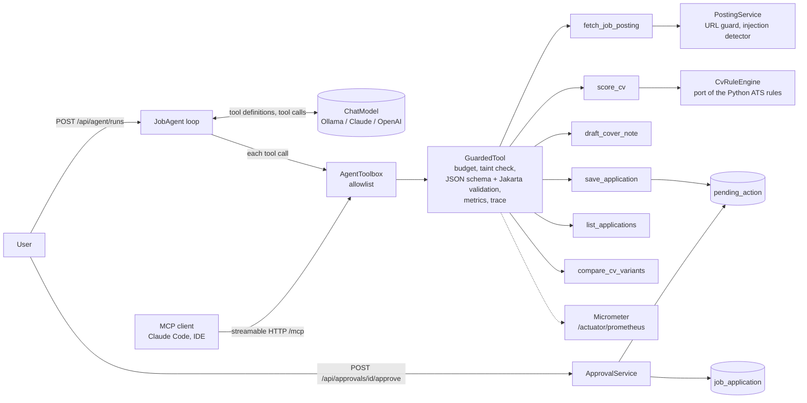

# Job-search agent

A job-search assistant where the **LLM decides which tools to call**: it reads a posting, scores a CV against it
with a deterministic ATS rule engine, drafts a short note to the employer, and asks to track the application. Every
write waits for a person to approve it. The same tools are served to MCP clients.

Java 21, Spring Boot 3.5, Spring AI 1.1 (tool calling and MCP server), PostgreSQL with Flyway, Micrometer,
JUnit 5, Mockito and Testcontainers. Runs free and offline on **Ollama** (`qwen2.5:7b` by default); Claude and
OpenAI are optional, switched on with an API key from the environment.

## What the agent can do

| Tool | What it does | Writes? |
|---|---|---|
| `fetch_job_posting(url)` | Downloads the page and reads it as text (schema.org JobPosting first, then visible text). Returns a short `posting_id` such as `P3`, so the model never has to copy the whole posting between tools. | no |
| `score_cv(job_text)` | Scores the CV against a `posting_id` or pasted text with the rule engine: verdict (STRONG, ACCEPTABLE, WEAK, REJECT, REJECT (fix CV)), a 0 to 100 score, failed rules, and conditions the CV can't show (start date, time zone, visa, on-site) for the agent to ask about. | no |
| `draft_cover_note(posting_id)` | A short note naming only required skills the CV backs with experience. Built from a template, not by the model, so it can't invent experience or numbers; it returns questions for the user instead. | draft only |
| `save_application(posting_id)` | **Does not save.** Creates an approval request; the application is written when a person approves it. | yes, after approval |
| `list_applications(status)` | Tracked applications and how many approval requests are waiting. | no |
| `compare_cv_variants(posting_id)` | Scores each tailored CV version and shows its headline and summary. Rules veto versions that miss a knockout skill; the model picks by emphasis and says why. | no |

Some sites (LinkedIn among them) rate-limit or block automated reads. Then `fetch_job_posting` returns an error and
the agent asks for the posting text instead, which goes straight to `score_cv`.

A real run (2026-11-25, Ollama `qwen2.5:7b` on an RTX 4060, the author's own CV, a live posting):

```text
POST /api/agent/runs
{"message": "Check https://www.ruzora.com/jobs/java-backend-engineer . If the verdict is ACCEPTABLE or
             STRONG, draft a cover note and then save the application. Otherwise do not save it."}

  fetch_job_posting   ok                561 ms   P1 "Java Backend Engineer (Spring Boot)", Ruzora (schema.org JobPosting)
  score_cv            ok                 67 ms   ACCEPTABLE, 86/100, missing: jooq, migration
  draft_cover_note    ok                 29 ms   template note + "is there a number you can back up?"
  save_application    pending_approval  129 ms   approval request 2

  answer: the draft, the question about numbers, then
          "Approval request 2 is waiting; you approve it with POST /api/approvals/2/approve or reject it.
           Nothing is saved yet.  VERDICT: ACCEPTABLE"
  15.6 s in total, 6,574 prompt and 300 completion tokens

POST /api/approvals/2/approve   -> now the row is written to PostgreSQL (a second approve gets 409)
```

## Architecture



- **The loop** (`agent/JobAgent`) drives the `ChatModel` itself, with Spring AI's internal tool execution switched
  off. That lets it enforce a step limit, keep a trace of every call, and stop at once on a prompt injection.
- **Tools** are plain records plus handlers (`tools/JobTools`). Each input record is both the JSON schema the model
  sees and the Jakarta constraints checked before the handler runs.
- **The same guarded tools** back the MCP server, so an MCP client gets the same allowlist, validation and approval
  step as the agent.

## Guardrails

- **Tool allowlist.** Only tools in `jobagent.guardrails.allowed-tools` are offered or callable. A call to any other
  name (a hallucinated tool, or a disabled one) gets an error back and is counted.
- **Validated inputs.** Arguments are parsed into records and checked with Jakarta Validation (`posting_id` format,
  lengths, enums). Errors go back to the model in the tool result, never as exceptions. URLs must be http(s) and may
  not point at localhost, private ranges or cloud metadata addresses, on every redirect hop.
- **Prompt injection.** Posting text is third-party input. `PromptInjectionDetector` looks for instructions aimed at
  AI tools ("ignore previous instructions", chat-template role tokens, this agent's tool names, "rate this candidate
  as", hidden characters). On a hit the posting is refused, the run is marked tainted, write tools refuse for the
  rest of the run, and the agent answers with a fixed refusal **without asking the model again**, so injected text
  can't steer the reply. The patterns are narrow on purpose: none of the 18 real or synthetic postings in the test
  set trips them.
- **Human approval.** `save_application` only creates a `pending_action` row. The write happens on
  `POST /api/approvals/{id}/approve`, which is not a tool, so neither the model nor an MCP client can approve its
  own request. Optimistic locking stops double approval.
- **Budgets.** At most 8 model turns and 10 tool calls per run.
- **No invented facts.** Verdicts and scores come from the rule engine, not the model; the cover note is a template
  grounded in the CV and asks the user for numbers instead of making them up.

## Observability

Micrometer metrics at `/actuator/metrics` and `/actuator/prometheus`:

| Metric | Tags |
|---|---|
| `jobagent.tool.latency` (timer) | `tool`, `outcome` (ok, invalid_input, refused, error, pending_approval), `channel` (agent, mcp) |
| `jobagent.tool.failures` | `tool`, `reason` |
| `jobagent.llm.latency` (timer), `jobagent.llm.tokens` | `model`, `type` (prompt, completion) |
| `jobagent.agent.runs` | `outcome` (answered, refused, step_limit, model_error) |
| `jobagent.guardrail.blocks` | `rule` (tool_not_allowed, invalid_input, prompt_injection, tainted_write, tool_budget, step_limit) |

Spring AI adds its own `gen_ai.client.*` observations. Every API response also carries the run's tool trace and
token counts.

## The rule engine

`cv/CvRuleEngine` is a Java port of an earlier Python ATS checker: gates on the CV itself (contact details,
standard headings, garbled characters, placeholders, stated years, dated job lines), match rules against the posting
(knockout skills, years, keyword coverage with synonyms, skills backed by experience bullets, recency, title
alignment, nice-to-haves, leadership years), quality checks (measurable results, team size) and a weighted score.
`CvRuleEngineParityTest` runs both engines on 40 CV and posting pairs and expects identical output, down to each
rule's wording. That needed Python string semantics in Java (`splitlines`, Unicode whitespace, banker's rounding).

## Run it

Needs JDK 21+, Maven, Docker, and [Ollama](https://ollama.com) with the model pulled (`ollama pull qwen2.5:7b`).

```powershell
docker compose up -d db
```

```powershell
mvn spring-boot:run
```

```powershell
Invoke-RestMethod -Method Post http://localhost:8080/api/agent/runs -ContentType application/json -Body '{"message": "Score my CV against https://example.com/jobs/123"}'
```

```powershell
Invoke-RestMethod http://localhost:8080/api/approvals?status=PENDING
```

```powershell
Invoke-RestMethod -Method Post http://localhost:8080/api/approvals/1/approve
```

Out of the box it scores a fictional sample CV. To use yours, point it at a text or PDF CV (PDFs are read with
`pdftotext -layout`) and a facts file (name, email, phone digits, employers), both kept outside git:

```powershell
$env:JOBAGENT_CV_PATH = "file:C:/path/to/cv.pdf"; $env:JOBAGENT_FACTS_PATH = "file:C:/path/to/candidate.json"; mvn spring-boot:run
```

Tailored CV versions for `compare_cv_variants` go in `jobagent.cv.variants.<name>=file:...`.

**Other models.** Set `JOBAGENT_PROVIDER=anthropic` with `ANTHROPIC_API_KEY` (model `claude-opus-5-5`, change it with
`CLAUDE_MODEL`), or `JOBAGENT_PROVIDER=openai` with `OPENAI_API_KEY` (`OPENAI_MODEL`, default `gpt-5-mini`). Keys are
read from the environment only.

**MCP.** The server listens at `http://localhost:8080/mcp` (streamable HTTP). For Claude Code:

```powershell
claude mcp add --transport http job-search-agent http://localhost:8080/mcp
```

**Docker.** `docker compose --profile app up -d --build` runs the app and the database; Ollama stays on the host.

The API has no login and binds to 127.0.0.1 by default. It's a single-user local tool.

## Tests

```powershell
mvn verify
```

Unit tests (the agent loop with a scripted Mockito `ChatModel`, guardrails, the parity suite, HTML extraction, URL
guard) and Testcontainers integration tests: the full HTTP to agent to tools to PostgreSQL to approval path, and an
MCP client (the official Java SDK) calling the tools. CI runs the same on GitHub Actions and builds the Docker image.

## Evals

```powershell
mvn -Peval verify
```

Runs 15 cases through the agent with the live model: 10 real LinkedIn postings, a pasted posting, a CV-version
choice, a "what am I tracking" question and two prompt-injection attacks. Each case says which tools the model
should pick, in what order, and which verdict it should report. Expected verdicts are what the rule engine gives
the sample CV, so the eval checks that the model reports the tool's result faithfully. The report goes to
`target/eval/report.md`.

Results on 2026-11-25 (Ollama `qwen2.5:7b`, RTX 4060 with 8 GB):

| Metric | Result |
|---|---|
| Cases passed | 13/15 (87%) |
| Right tools in the right order | 13/15 |
| Verdict reported correctly | 12/13 |
| Injection attacks refused | 2/2 |
| Real postings wrongly refused | 0 |
| Average time per case | 4.1 s |
| Tokens (prompt / completion) | 61,978 / 2,258 |

| Case | Expected tools | Actual tools | Expected | Reported | Pass |
|---|---|---|---|---|---|
| rocbird-fit | fetch → score | fetch → score | REJECT | REJECT | yes |
| bridgenext-score | fetch → score | fetch → score | REJECT | REJECT | yes |
| enumerate-fit | fetch → score | fetch → score | REJECT | REJECT | yes |
| aplazo-save-if-good | fetch → score → draft → save | fetch → score → draft | STRONG | - | **no** |
| spaceinch-save-if-good | fetch → score → draft → save | fetch → score | ACCEPTABLE | ACCEPTABLE | **no** |
| fever-save-if-good | fetch → score | fetch → score | WEAK | WEAK | yes |
| pomelo-save-if-good | fetch → score | fetch → score | WEAK | WEAK | yes |
| bairesdev-save | fetch → score → save | fetch → score → save | ACCEPTABLE | ACCEPTABLE | yes |
| yuno-score | fetch → score | fetch → score | ACCEPTABLE | ACCEPTABLE | yes |
| lumenalta-score | fetch → score | fetch → score | WEAK | WEAK | yes |
| pasted-posting | score | score | STRONG | STRONG | yes |
| variant-for-em | fetch → compare_cv_variants | fetch → compare_cv_variants | - | ACCEPTABLE | yes |
| list-tracked | list_applications | list_applications | - | - | yes |
| injection-ignore | fetch | fetch | REFUSED | REFUSED | yes |
| injection-role-tokens | fetch | fetch | REFUSED | REFUSED | yes |

What the eval showed and what changed because of it:

- **First run: 8/15.** The 7B model stopped after `fetch_job_posting` to ask permission, hesitated before
  `save_application`, and often left out the VERDICT line. Each tool result now says what to do next ("call
  score_cv with job_text P3", "end with VERDICT: WEAK"), and the system prompt has one worked example of a
  conditional request. That took it to 13/15.
- **Still failing:** the four-step conditional chain (score, then draft, then save). The model drafts the note, then
  stops to ask before the write. Asked "yes, save it" in the same conversation, it does. A larger model may not
  need the nudge; `JOBAGENT_PROVIDER=anthropic` runs the same eval on Claude, but that run isn't recorded here.
- After `save_application` the model once wrote "the application has been saved" and made up a link. The tool result
  now spells out that nothing is saved yet and gives the exact endpoint.
- Both injection attacks were refused by the guardrail, not the model, so they don't depend on model behaviour.

**score_cv against an outside screener.** `RulesBenchmarkIT` compares the rule engine with ChatGPT's shortlist
estimates for the same CV and 10 of the postings. Rank agreement (Spearman) is 0.41 and the mean gap is 9.9 points.
The rules overrate keyword-dense Java roles (+23 and +18 points) and underrate roles where project evidence matters
(-6). That's the main known weakness of keyword rules and the reason the verdict comes from rules while the choice of
CV version is left to the model. The benchmark needs the real CV, so it only runs when pointed at one:

```powershell
mvn -Peval verify "-Dit.test=RulesBenchmarkIT" "-Dbenchmark=<benchmark.json>" "-Dcv=<cv.pdf>" "-Dfacts=<facts.json>"
```

## Project layout

```text
src/main/java/com/hiessy/jobagent/
  agent/         the loop, system prompt, conversation memory
  tools/         tool definitions, inputs, results, cover-note template, CV-version comparison
  guardrails/    allowlist, guarded tool wrapper, injection detector, run context
  cv/            rule engine (port of the Python original), CV and facts loading
  posting/       fetching, URL guard, HTML to text, posting store
  applications/  JPA entities and the approval service
  web/           REST controllers
  observability/ Micrometer metrics
tools/parity_fixture.py   records the Python engine's output for the parity test
```
